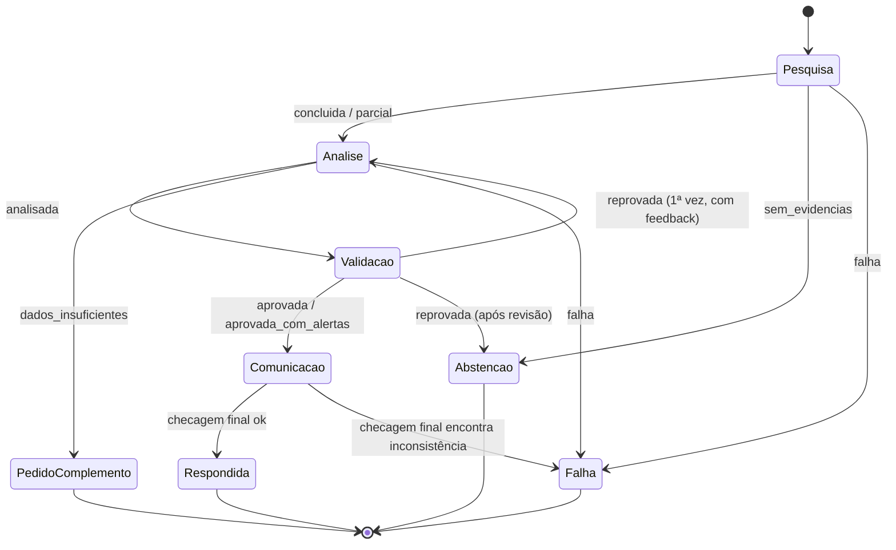

# Contratos e responsabilidades dos quatro agentes

Referência: [S4-01 / #75](https://github.com/anamattos2/grupo11challenge2/issues/75).
Depende de: [arquitetura inicial (BASE-01 / #55)](../arquitetura-inicial.md),
seções 3 e 4. Consumido por: Research (S4-02 / #76), orquestrador (S4-06 / #80)
e pelas issues dos demais agentes.

Estado: proposta para revisão da equipe. Este documento especifica contratos
e o grafo do fluxo; ele não implementa Analysis, Validation e Communication.

Stack: **Pydantic** para os contratos, **LangGraph** para o fluxo entre agentes
e **LangChain** para ferramentas e modelo (S4-02). A escolha segue o que mais
aparece em vagas de engenharia de IA e é compatível com Ollama local, previsto
em `docs/desenvolvimento/ambiente.md`. A decisão final de provedor continua
sendo a P03 da arquitetura.

## 1. Por que contratos

Um "agente" aqui é uma etapa com um papel fixo que recebe dados estruturados,
pode usar ferramentas ou um modelo de linguagem, e devolve dados estruturados.
O texto que um LLM gera é **não confiável** até ser validado. Por isso, cada
etapa tem um schema de entrada e de saída, e o orquestrador recusa qualquer
saída que não respeite o schema antes de passar adiante.

Fonte da verdade: modelos Pydantic em
[`finance_ai/agents/contratos.py`](../../../packages/ai/src/finance_ai/agents/contratos.py).
Os JSON Schemas em [`contracts/agentes/schemas`](../../../contracts/agentes/schemas)
são gerados a partir deles e servem a quem não usa Python.

Convenções válidas para todos os contratos:

| Convenção | Motivo |
|---|---|
| Campos extras são recusados (`additionalProperties: false`) | Um modelo não consegue acrescentar `usuaria_id`, operações ou parâmetros fora do previsto |
| Objetos imutáveis | Uma etapa não altera a saída da anterior |
| Dinheiro como texto decimal (`"1850.40"`) | Mesmo formato da API financeira (BE-03/BE-04), sem erro de `float` |
| IDs de evidência com prefixo `doc:` ou `fin:` | Documento educativo e dado pessoal nunca se confundem |
| Campo `versao` nas saídas | Permite evoluir o contrato sem quebrar consumidores sem aviso |

## 2. Contexto autorizado

O `ContextoAutorizado` é montado **pelo backend** a partir da sessão. Nenhum
agente, prompt ou corpo de requisição define quem é a usuária.

| Campo | Quem preenche | Uso |
|---|---|---|
| `correlation_id` | Backend | Rastreio em logs, etapas e resposta |
| `usuaria_ref` | Backend, a partir de `request.auth` | Repassado às ferramentas pelo código; não entra em prompts |
| `conversa_id` | Backend | Conversa pertencente à usuária |
| `permissoes` | Backend | Lista fechada: `documentos:ler`, `financeiro:ler`. Não existe escrita |
| `data_referencia` | Backend | Data atual em America/Sao_Paulo; resolve "este mês" |
| `memoria` | Backend | No máximo 5 itens de até 500 caracteres, já filtrados |

A autorização acontece em camadas: o backend monta o contexto; o agente só
chama ferramentas permitidas no contexto; e cada ferramenta volta a filtrar
pela usuária, como já fazem `RegistroDaUsuaria.objects.da_usuaria(...)` e as
rotas da BE-03/BE-04. A Validation acrescenta checagens de consistência, mas
não substitui essa autorização.

## 3. Papéis distintos

| Papel | Faz | Não faz | Entrada | Saída |
|---|---|---|---|---|
| **Research** | Planeja e executa buscas no corpus e consultas financeiras autorizadas; converte resultados em evidências com tipo, origem, ID e localização | Interpretar, concluir, calcular, escrever para a usuária | `EntradaPesquisa` | `SaidaPesquisa` |
| **Analysis** | Transforma evidências em afirmações curtas, cada uma ligada a IDs de evidência; registra lacunas | Buscar dados novos, calcular valores oficiais, citar evidência que não recebeu | `EntradaAnalise` | `SaidaAnalise` |
| **Validation** | Confere referências, natureza, números, suporte e escopo; aprova ou reprova | Reescrever a análise, criar afirmações | `EntradaValidacao` | `SaidaValidacao` |
| **Communication** | Redige a resposta em português com fontes e ligações afirmação → evidência | Usar afirmação não aprovada, trocar a evidência de uma afirmação | `EntradaComunicacao` | `SaidaComunicacao` |
| **Orquestrador** | Valida contratos, aplica o fluxo, controla tempo, monta a resposta final | Substituir qualquer agente | todas | `RespostaFinal` |

Os testes conferem que as quatro saídas têm campos diferentes e que só a
Research produz `evidencias`, só a Analysis produz `afirmacoes`, só a Validation
tem `decisao` e só a Communication tem `texto`.

### Naturezas de afirmação

| Natureza | Deve citar | Exemplo |
|---|---|---|
| `dado_pessoal` | Evidência `fin:` | "Em outubro você registrou R$ 1.850,40 em despesas essenciais." |
| `calculo` | Evidência `fin:` com o resultado calculado pelo backend | "Faltam R$ 4.149,60 para a meta." |
| `orientacao_educativa` | Evidência `doc:` | "A reserva cobre despesas essenciais em imprevistos." |

A Analysis não calcula: números vêm prontos das ferramentas (decisão D05 da
arquitetura). A regra `numeros_conferem` da Validation verifica se cada valor
citado no texto aparece nos `valores` da evidência financeira indicada.

### Regras da Validation

| Regra | Reprova quando |
|---|---|
| `referencias_existentes` | Afirmação cita ID que não está na `SaidaPesquisa` desta requisição |
| `natureza_compativel` | Dado pessoal ou cálculo sem evidência `fin:`; orientação sem evidência `doc:` |
| `numeros_conferem` | Valor no texto diverge do valor retornado pela ferramenta |
| `suporte_documental` | Trecho citado não sustenta a orientação |
| `escopo_permitido` | Recomendação de ativo específico, menção a acesso bancário ou ação de escrita |

`alerta` não bloqueia (ex.: fonte sintética, score baixo, pesquisa parcial).
`falha` em qualquer regra bloqueia e exige `motivo_bloqueio`.

## 4. Evidências

As duas formas compartilham `tipo`, `id`, `origem` e `localizacao`.

| Campo | Documental (`doc:`) | Financeira (`fin:`) |
|---|---|---|
| `id` | `doc:` + início do `chunk_id` | `fin:<operacao>:<hash dos parâmetros>` |
| `origem` | `document_id` do catálogo, `source_sha256`, título, `sintetica` | Operação, rota de referência do backend, `sintetica` |
| `localizacao` | Página, offsets `inicio`/`fim` no texto limpo, `chunk_id` | Período, filtros e IDs dos registros considerados |
| Conteúdo | `trecho`, `score`, `consulta` | `moeda`, `valores` decimais, `resumo` gerado pela ferramenta |

Os campos documentais vêm do contrato v1 da
[recuperação documental (S2-05 / #67)](https://github.com/anamattos2/grupo11challenge2/issues/67):
`chunk_id`, `document_id`, `source_sha256`, `page_number`, `start`, `end`,
`text`, `score`. O score é similaridade, não probabilidade de correção.

## 5. Fluxo de aprovação, abstenção e falha

Especificação executável em duas camadas:

- [`fluxo.py`](../../../packages/ai/src/finance_ai/agents/fluxo.py): as regras
  de transição como funções puras (`apos_pesquisa`, `apos_analise`...).
- [`grafo.py`](../../../packages/ai/src/finance_ai/agents/grafo.py): o mesmo
  fluxo como `StateGraph` do **LangGraph**. Cada nó chama um agente, valida a
  saída contra o contrato e grava a transição decidida por `fluxo.py`; as arestas
  condicionais só leem essa transição. O estado (`EstadoFluxo`) acumula as
  etapas com um redutor, o que dá o rastro da resposta final.

O diagrama abaixo é a versão comentada. A versão gerada pelo próprio grafo
(`get_graph().draw_mermaid()`) fica em
[`contracts/agentes/fluxo.mmd`](../../../contracts/agentes/fluxo.mmd), e um
teste garante que ela corresponde ao código.

Além das setas, qualquer etapa vai para **Falha** quando lança exceção, excede
o tempo (`TimeoutError`) ou devolve saída fora do contrato (`falha_de_etapa`).
No grafo, isso é tratado dentro de cada nó: o erro vira uma `EtapaRastro` com
código (`excecao`, `tempo_esgotado`, `contrato_invalido`) e a mensagem interna
nunca chega à usuária.

| Desfecho | Significado | Texto ao usuário | Fontes |
|---|---|---|---|
| `respondida` | Validação aprovou e a checagem final passou | Texto da Communication | Obrigatórias |
| `abstencao` | O sistema funcionou, mas não há base suficiente | Mensagem fixa, sem LLM | Nenhuma |
| `pedido_complemento` | Falta dado que só a usuária informa | Mensagem fixa + perguntas das lacunas | Nenhuma |
| `falha` | Um componente quebrou | Mensagem fixa: nenhum dado foi alterado | Nenhuma |

Regras de segurança do fluxo:

1. A análise reprovada **nunca** chega à Communication; o contrato
   `EntradaComunicacao` recusa validação `reprovada`.
2. Abstenção e falha não reaproveitam texto da análise; usam mensagens fixas.
3. A Analysis tem no máximo **uma** revisão após reprovação (`MAX_REVISOES_PADRAO`).
   Depois disso, abstenção.
4. Checagem final determinística (`inconsistencias_comunicacao`): a Communication
   só usa afirmações aprovadas, não troca a evidência de uma afirmação e só cita
   fontes existentes na pesquisa.
5. Nenhum desfecho grava dados financeiros.

### Códigos de motivo

`sem_evidencias`, `dados_insuficientes`, `validacao_reprovada`,
`falha_pesquisa`, `falha_analise`, `falha_validacao`, `falha_comunicacao`,
`comunicacao_inconsistente`, `contrato_invalido`, `tempo_esgotado`.
O frontend pode escolher ícones e textos pelo código; o `texto` já é seguro
para exibição.

## 6. Exemplos

O mesmo caso fictício atravessa os quatro agentes: "Quanto gastei com despesas
essenciais em outubro e por que devo ter uma reserva de emergência?".
Veja [`contracts/agentes/README.md`](../../../contracts/agentes/README.md)
para a lista de exemplos válidos e inválidos e o motivo de cada recusa.

## 7. Como alterar um contrato

1. Altere o modelo em `contratos.py` e, se preciso, `fluxo.py` e `grafo.py`.
2. Rode `python scripts/exportar_schemas_agentes.py` e revise o diff dos schemas
   e do `fluxo.mmd`.
3. Atualize ou acrescente exemplos válidos e inválidos.
4. Rode `python -m unittest discover -s tests`.
5. Peça revisão de quem produz e de quem consome o contrato. Mudança que
   remove campo, muda tipo ou torna campo obrigatório incrementa a versão.

A CI executa `exportar_schemas_agentes.py --check` e falha se os schemas ou o
diagrama estiverem desatualizados em relação ao código.

## 8. Pendências

| Pendência | Onde resolver |
|---|---|
| Valores de timeout por etapa, tempo total, checkpointer e rastros (LangSmith ou equivalente) | S4-06 / #80 (P09 da arquitetura) |
| Prompt e LLM de Analysis e Communication (LangChain + Ollama, como na S4-02) | Issues dos agentes + P03 |
| Implementação da Validation (regras acima) | Issue da Validation |
| Operação `situacao_reserva` no backend | BE-05 (cálculo da reserva) |
| Limiar de score e alertas de fonte | Avaliação RAG (P07) |

## 9. Critérios de aceite

| Critério da #75 | Evidência |
|---|---|
| Schemas e exemplos válidos e inválidos disponíveis | 11 schemas em `contracts/agentes/schemas`; 20 exemplos válidos e 18 inválidos; `tests/test_contratos_agentes.py` |
| Research, Analysis, Validation e Communication têm papéis distintos | Seção 3; `test_papeis_tem_saidas_distintas` |
| Fluxo de aprovação, abstenção e falha especificado | Seção 5; `fluxo.py` e `grafo.py` (LangGraph); `tests/test_fluxo_agentes.py` e `tests/test_grafo_agentes.py` |
