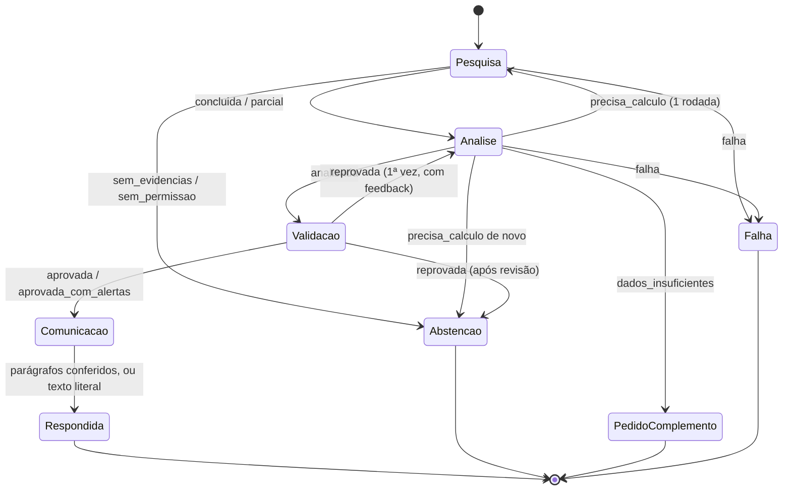

# Contratos e responsabilidades dos quatro agentes

Referência: [S4-01 / #75](https://github.com/anamattos2/grupo11challenge2/issues/75).
Depende de: [arquitetura inicial (BASE-01 / #55)](../arquitetura-inicial.md),
seções 3 e 4. Consumido por: Research (S4-02 / #76), orquestrador (S4-06 / #80)
e pelas issues dos demais agentes.

Estado: proposta para revisão da equipe. Este documento especifica contratos
e o grafo do fluxo; ele não implementa Analysis, Validation e Communication.

Stack: **Pydantic** para os contratos, **LangGraph** para o fluxo entre agentes
e **LangChain** para ferramentas e modelo (S4-02). A escolha segue o que mais
aparece em vagas de engenharia de IA e é compatível com Ollama local, previsto
em `docs/desenvolvimento/ambiente.md`. A decisão final de provedor continua
sendo a P03 da arquitetura.

## 1. Por que contratos

Um "agente" aqui é uma etapa com um papel fixo que recebe dados estruturados,
pode usar ferramentas ou um modelo de linguagem, e devolve dados estruturados.
O texto que um LLM gera é **não confiável** até ser validado. Por isso, cada
etapa tem um schema de entrada e de saída, e o orquestrador recusa qualquer
saída que não respeite o schema antes de passar adiante.

Fonte da verdade: modelos Pydantic em
[`finance_ai/agents/contratos.py`](../../../packages/ai/src/finance_ai/agents/contratos.py).
Os JSON Schemas em [`contracts/agentes/schemas`](../../../contracts/agentes/schemas)
são gerados a partir deles e servem a quem não usa Python.

Convenções válidas para todos os contratos:

| Convenção | Motivo |
|---|---|
| Campos extras são recusados (`additionalProperties: false`) | Um modelo não consegue acrescentar `usuaria_id`, operações ou parâmetros fora do previsto |
| Objetos imutáveis por inteiro: `frozen=True`, listas como tuplas (`Lista`) e dicionários como `MappingProxyType` (`MapaTexto`, `MapaValores`) | `frozen` sozinho ainda deixaria `saida.evidencias.append(...)` funcionar. No JSON nada muda |
| Cópia na passagem entre agentes (`Contrato.copia`, `ler_contrato`) | Cada agente recebe objetos próprios e o estado guarda objetos revalidados, nunca a referência que o agente devolveu |
| Dinheiro como texto decimal (`"1850.40"`) | Mesmo formato da API financeira (BE-03/BE-04), sem erro de `float` |
| IDs de evidência com prefixo `doc:` ou `fin:` | Documento educativo e dado pessoal nunca se confundem |
| Campo `versao` nas saídas | Permite evoluir o contrato sem quebrar consumidores sem aviso |

## 2. Contexto autorizado

O `ContextoAutorizado` é montado **pelo backend** a partir da sessão. Nenhum
agente, prompt ou corpo de requisição define quem é a usuária.

| Campo | Quem preenche | Uso |
|---|---|---|
| `correlation_id` | Backend | Rastreio em logs, etapas e resposta |
| `usuaria_ref` | Backend, a partir de `request.auth` | Repassado às ferramentas pelo código; não entra em prompts |
| `conversa_id` | Backend | Conversa pertencente à usuária |
| `permissoes` | Backend | Lista fechada: `documentos:ler`, `financeiro:ler`. Não existe escrita |
| `data_referencia` | Backend | Data atual em America/Sao_Paulo; resolve "este mês" |
| `memoria` | Backend | No máximo 5 itens de até 500 caracteres, já filtrados |

A autorização acontece em camadas: o backend monta o contexto; o agente só
chama ferramentas permitidas no contexto; e cada ferramenta volta a filtrar
pela usuária, como já fazem `RegistroDaUsuaria.objects.da_usuaria(...)` e as
rotas da BE-03/BE-04. A Validation acrescenta checagens de consistência, mas
não substitui essa autorização.

## 3. Papéis distintos

| Papel | Faz | Não faz | Entrada | Saída |
|---|---|---|---|---|
| **Research** | Planeja e executa buscas no corpus e consultas financeiras autorizadas; executa sem planejar as `chamadas_solicitadas` (cálculos pedidos pela Analysis); converte resultados em evidências com tipo, origem, ID e localização | Interpretar, concluir, calcular, escrever para a usuária | `EntradaPesquisa` | `SaidaPesquisa` |
| **Analysis** | Transforma evidências em afirmações curtas (até 5), cada uma ligada a IDs de evidência; pede cálculos tipados (`PedidoCalculo`) quando falta um número; registra lacunas | Buscar dados novos, calcular valores oficiais, citar evidência que não recebeu | `EntradaAnalise` | `SaidaAnalise` |
| **Validation** | Confere referências, natureza, números, suporte e escopo; aprova ou reprova | Reescrever a análise, criar afirmações | `EntradaValidacao` | `SaidaValidacao` |
| **Communication** | Redige parágrafos em português, cada um declarando as afirmações aprovadas que expressa | Escolher fontes, criar ligações, citar por conta própria, trazer número que não está nas afirmações | `EntradaComunicacao` | `SaidaComunicacao` |
| **Orquestrador** | Valida e copia contratos, aplica o fluxo, controla tempo, confere a redação e monta texto, citações, fontes e ligações | Substituir qualquer agente | todas | `RespostaFinal` |

Os testes conferem que as quatro saídas têm campos diferentes e que só a
Research produz `evidencias`, só a Analysis produz `afirmacoes`, só a Validation
tem `decisao` e só a Communication tem `paragrafos`.

### Naturezas de afirmação

| Natureza | Deve citar | Exemplo |
|---|---|---|
| `dado_pessoal` | Evidência `fin:` | "Em outubro você registrou R$ 1.850,40 em despesas essenciais." |
| `calculo` | Evidência `fin:` com o resultado calculado pelo backend | "Faltam R$ 4.149,60 para a meta." |
| `orientacao_educativa` | Evidência `doc:` | "A reserva cobre despesas essenciais em imprevistos." |

A Analysis não calcula: números vêm prontos das ferramentas (decisão D05 da
arquitetura). A regra `numeros_conferem` da Validation verifica se cada valor
citado no texto aparece nos `valores` da evidência financeira indicada.

### Pedido de cálculo (Analysis → Research)

Quando a pergunta precisa de um número que a Research não trouxe (ex.: comparar
outubro com setembro), a Analysis devolve `status = "precisa_calculo"` com até
três `PedidoCalculo`:

```json
{"id": "c1", "operacao": "resumo_transacoes",
 "parametros": {"periodo_inicio": "2026-09-01", "periodo_fim": "2026-09-30", "tipo": "despesa"},
 "motivo": "A pergunta compara outubro com setembro; setembro não veio na pesquisa."}
```

O pedido usa a mesma lista fechada de operações da Research, então a Analysis
continua sem calcular nada (D05). O orquestrador transforma cada pedido em
`ChamadaFerramenta` com `pedido_id`, a Research executa exatamente essas
chamadas, `mesclar_pesquisas` junta o resultado à pesquisa original e a
Analysis roda de novo, com `calculos_ja_pedidos` preenchido. Há **uma** rodada
(`MAX_RODADAS_CALCULO`); um segundo pedido, ou um pedido repetido, termina em
abstenção com motivo `calculo_indisponivel`. Novos tipos de cálculo entram como
novas operações em `OperacaoFinanceira`, implementadas no backend.

### Regras da Validation

| Regra | Reprova quando |
|---|---|
| `referencias_existentes` | Afirmação cita ID que não está na `SaidaPesquisa` desta requisição |
| `natureza_compativel` | Dado pessoal ou cálculo sem evidência `fin:`; orientação sem evidência `doc:` |
| `numeros_conferem` | Valor no texto diverge do valor retornado pela ferramenta |
| `suporte_documental` | Trecho citado não sustenta a orientação |
| `escopo_permitido` | Recomendação de ativo específico, menção a acesso bancário ou ação de escrita |

`alerta` não bloqueia (ex.: fonte sintética, score baixo, pesquisa parcial).
`falha` em qualquer regra bloqueia e exige `motivo_bloqueio`.

## 4. Evidências

As duas formas compartilham `tipo`, `id`, `origem` e `localizacao`.

| Campo | Documental (`doc:`) | Financeira (`fin:`) |
|---|---|---|
| `id` | `doc:` + início do `chunk_id` | `fin:<operacao>:<hash dos parâmetros>` |
| `origem` | `document_id` do catálogo, `source_sha256`, título, `sintetica` | Operação, rota de referência do backend, `sintetica` |
| `localizacao` | Página, offsets `inicio`/`fim` no texto limpo, `chunk_id` | Período, filtros e IDs dos registros considerados |
| Conteúdo | `trecho`, `score`, `consulta` | `moeda`, `valores` decimais, `resumo` gerado pela ferramenta |

### Status da pesquisa

O status não é escolhido pelo agente: `status_da_pesquisa` o deriva das
chamadas, e o contrato recusa qualquer outro valor.

| Evidências | Chamadas | Status | Desfecho |
|---|---|---|---|
| sim | todas ok / sem resultados | `concluida` | Analysis |
| sim | alguma negada ou com erro | `parcial` | Analysis, com observação |
| não | alguma com erro | `falha` | Falha (`falha_pesquisa`) |
| não | nenhum erro, alguma negada | `sem_permissao` | Abstenção (`sem_permissao`) |
| não | só buscas sem resultados | `sem_evidencias` | Abstenção (`sem_evidencias`) |

Erro de ferramenta nunca vira "não encontrei", e uma fonte negada nunca fica
escondida atrás de "não encontrei": a abstenção por busca vazia só acontece
quando todas as ferramentas responderam de fato "sem resultados". Toda pesquisa
registra ao menos uma chamada.

Os campos documentais vêm do contrato v1 da
[recuperação documental (S2-05 / #67)](https://github.com/anamattos2/grupo11challenge2/issues/67):
`chunk_id`, `document_id`, `source_sha256`, `page_number`, `start`, `end`,
`text`, `score`. O score é similaridade, não probabilidade de correção.

## 5. Fluxo de aprovação, abstenção e falha

Especificação executável em duas camadas:

- [`fluxo.py`](../../../packages/ai/src/finance_ai/agents/fluxo.py): as regras
  de transição como funções puras (`apos_pesquisa`, `apos_analise`...).
- [`grafo.py`](../../../packages/ai/src/finance_ai/agents/grafo.py): o mesmo
  fluxo como `StateGraph` do **LangGraph**. Cada nó chama um agente, valida a
  saída contra o contrato e grava a transição decidida por `fluxo.py`; as arestas
  condicionais só leem essa transição. O estado (`EstadoFluxo`) acumula as
  etapas com um redutor, o que dá o rastro da resposta final.

O diagrama abaixo é a versão comentada. A versão gerada pelo próprio grafo
(`get_graph().draw_mermaid()`) fica em
[`contracts/agentes/fluxo.mmd`](../../../contracts/agentes/fluxo.mmd), e um
teste garante que ela corresponde ao código.



Além das setas, qualquer etapa até a Validation vai para **Falha** quando lança exceção, excede
o tempo (`TimeoutError`) ou devolve saída fora do contrato (`falha_de_etapa`).
No grafo, isso é tratado dentro de cada nó: o erro vira uma `EtapaRastro` com
código (`excecao`, `tempo_esgotado`, `contrato_invalido`) e a mensagem interna
nunca chega à usuária. A Communication é a exceção: como o conteúdo já foi
aprovado, uma falha dela não derruba a resposta, que sai com o texto literal.

| Desfecho | Significado | Texto ao usuário | Fontes |
|---|---|---|---|
| `respondida` | Validação aprovou | Parágrafos da Communication conferidos (`redacao = communication`) ou texto literal das afirmações aprovadas (`redacao = literal`); citações numeradas pelo orquestrador | Obrigatórias, com ligações afirmação → evidência |
| `abstencao` | O sistema funcionou, mas não há base suficiente | Mensagem fixa, sem LLM | Nenhuma |
| `pedido_complemento` | Falta dado que só a usuária informa | Mensagem fixa + perguntas das lacunas | Nenhuma |
| `falha` | Um componente quebrou | Mensagem fixa: nenhum dado foi alterado | Nenhuma |

### Referências entre etapas

Cada contrato valida a saída de um agente isoladamente; ids que passam de
uma etapa para outra são conferidos pelo fluxo:

| Checagem | Onde | Se falhar |
|---|---|---|
| Evidências citadas pela Analysis existem na pesquisa | `inconsistencias_analise`, em `apos_analise` | Falha `contrato_invalido`; etapa `referencia_inexistente` no rastro |
| Afirmações aprovadas, marcadas sem suporte ou verificadas pela Validation existem na análise | `inconsistencias_validacao`, em `apos_validacao` | Falha `contrato_invalido`; etapa `referencia_inexistente` |
| As duas checagens de novo, antes de montar a resposta | início de `montar_resposta` | `ValueError` (nunca `KeyError`), que o grafo transforma em falha |

Além disso, nenhum nó do grafo deixa exceção escapar (`_protegido`), e
`executar_fluxo` sempre devolve uma `RespostaFinal`: um erro inesperado do
próprio orquestrador termina em falha com motivo `erro_interno`.

O feedback de uma reprovação fica no estado do grafo (`feedback_validacao`),
e não na transição, para chegar à Analysis mesmo quando há um pedido de
cálculo entre a reprovação e a nova análise.

Regras de segurança do fluxo:

1. A análise reprovada **nunca** chega à Communication; o contrato
   `EntradaComunicacao` recusa validação `reprovada`.
2. Abstenção e falha não reaproveitam texto da análise; usam mensagens fixas.
3. A Analysis tem no máximo **uma** revisão após reprovação (`MAX_REVISOES_PADRAO`).
   Depois disso, abstenção.
4. A resposta final só expressa afirmações aprovadas. A Communication entrega
   parágrafos que declaram quais afirmações expressam; `inconsistencias_comunicacao`
   confere que (a) só há afirmações aprovadas, (b) todo número do parágrafo está
   no texto dessas afirmações (reformatar "1850.40" como "R$ 1.850,40" é aceito;
   número novo ou marca de citação manual não) e (c) toda afirmação aprovada
   aparece. Se algo falhar, `montar_resposta` usa o texto literal das
   afirmações aprovadas. Fontes, numeração e ligações são sempre derivadas das
   evidências que a Analysis indicou, nunca escritas pela Communication.
   Limite: uma frase nova **sem números** não é detectável por regra; a
   implementação da Communication (S4-05) deve trazer avaliação própria.
5. Nenhum desfecho grava dados financeiros.

### Códigos de motivo

`sem_evidencias`, `sem_permissao`, `dados_insuficientes`, `calculo_indisponivel`,
`validacao_reprovada`, `falha_pesquisa`, `falha_analise`, `falha_validacao`,
`falha_comunicacao`, `contrato_invalido`, `tempo_esgotado`, `erro_interno`. Quando a redação da
Communication é substituída pela literal, a resposta continua `respondida` e
o rastro ganha uma etapa do orquestrador com código `redacao_substituida`.
O frontend pode escolher ícones e textos pelo código; o `texto` já é seguro
para exibição.

## 6. Exemplos

O mesmo caso fictício atravessa os quatro agentes: "Quanto gastei com despesas
essenciais em outubro e por que devo ter uma reserva de emergência?".
Veja [`contracts/agentes/README.md`](../../../contracts/agentes/README.md)
para a lista de exemplos válidos e inválidos e o motivo de cada recusa.

## 7. Como alterar um contrato

1. Altere o modelo em `contratos.py` e, se preciso, `fluxo.py` e `grafo.py`.
2. Rode `python scripts/exportar_schemas_agentes.py` e revise o diff dos schemas
   e do `fluxo.mmd`.
3. Atualize ou acrescente exemplos válidos e inválidos.
4. Rode `python -m unittest discover -s tests`.
5. Peça revisão de quem produz e de quem consome o contrato. Mudança que
   remove campo, muda tipo ou torna campo obrigatório incrementa a versão.

A CI executa `exportar_schemas_agentes.py --check` e falha se os schemas ou o
diagrama estiverem desatualizados em relação ao código.

## 8. Pendências

| Pendência | Onde resolver |
|---|---|
| Valores de timeout por etapa, tempo total, checkpointer e rastros (LangSmith ou equivalente) | S4-06 / #80 (P09 da arquitetura) |
| Prompt e LLM de Analysis e Communication (LangChain + Ollama, como na S4-02) | Issues dos agentes + P03 |
| Implementação da Validation (regras acima) | Issue da Validation |
| Operação `situacao_reserva` no backend | BE-05 (cálculo da reserva) |
| Limiar de score e alertas de fonte | Avaliação RAG (P07) |
| Avaliação do texto da Communication além da checagem por regra | S4-05 (Communication) |
| Adoção do LangGraph (as regras de `fluxo.py` não dependem dele) | Decisão da equipe |

## 9. Critérios de aceite

| Critério da #75 | Evidência |
|---|---|
| Schemas e exemplos válidos e inválidos disponíveis | 11 schemas em `contracts/agentes/schemas`; 25 exemplos válidos e 25 inválidos; `tests/test_contratos_agentes.py` |
| Research, Analysis, Validation e Communication têm papéis distintos | Seção 3; `test_papeis_tem_saidas_distintas` |
| Fluxo de aprovação, abstenção e falha especificado | Seção 5; `fluxo.py` e `grafo.py` (LangGraph); `tests/test_fluxo_agentes.py` e `tests/test_grafo_agentes.py` |

### Ajustes da revisão do PR #135

| Pedido da revisão | Mudança | Testes |
|---|---|---|
| Texto final pode conter afirmação não aprovada | Communication entrega `paragrafos` ligados a afirmações; orquestrador confere e monta texto, citações, fontes e ligações; reserva literal | `RespostaFinalTest` (fluxo); `test_redacao_com_afirmacao_nao_aprovada_sai_literal`, `test_falha_da_communication_nao_perde_o_conteudo_aprovado` (grafo) |
| Como a Analysis pede cálculo determinístico | `PedidoCalculo`, status `precisa_calculo`, `chamadas_solicitadas`, aresta `analise → pesquisa` com uma rodada | `PedidoDeCalculoTest`; `test_pedido_de_calculo_volta_a_research_e_completa_a_analise`, `test_segundo_pedido_de_calculo_abstem` |
| Falha ou negação aceitas como `sem_evidencias` | Status derivado por `status_da_pesquisa`; novo `sem_permissao`; erro sempre vira `falha` | `PesquisaTest`; `test_busca_vazia_sem_permissao_e_falha_terminam_de_formas_diferentes` |
| `frozen=True` permite alterar listas e dicionários | Tuplas e `MappingProxyType` em todos os contratos; cópia na passagem entre agentes | `test_nenhum_contrato_guarda_lista_ou_dicionario_mutavel`, `test_copia_e_independente_e_igual`, `test_agente_nao_consegue_alterar_o_que_recebeu_nem_o_estado` |

### Segunda revisão do PR #135 e testes exaustivos

A segunda revisão encontrou um `KeyError` quando a Validation aprovava um id
inexistente na análise. Ele foi corrigido numa branch de correção, porque o
PR já tinha sido mesclado.

| Ponto da revisão | Mudança | Testes |
|---|---|---|
| Bloqueante: Validation aprova id que não existe → `KeyError` escapa do fluxo | `inconsistencias_validacao` em `apos_validacao` e em `montar_resposta`; `no_respondida` captura qualquer exceção; nós protegidos; `executar_fluxo` nunca lança | `ReferenciasCruzadasTest`; `test_validation_aprovando_id_inexistente_vira_falha_e_nao_excecao`; `test_erro_dentro_do_orquestrador_nunca_escapa` |
| Feedback perdido quando a revisão passa por pedido de cálculo | `feedback_validacao` guardado no estado | `test_feedback_da_reprovacao_sobrevive_a_um_pedido_de_calculo` |
| `negada` + `sem_resultados` escondia a negação | Vira `sem_permissao` | `PesquisaTest`; `StatusDaPesquisaExaustivoTest` |
| Evidências da Analysis não conferidas contra a pesquisa | `inconsistencias_analise` em `apos_analise` | `test_analysis_citando_evidencia_inexistente_vira_falha_e_nao_chega_a_validation` |

`tests/test_grafo_exaustivo.py` roda o grafo com todas as combinações de um
cardápio de comportamentos dos quatro agentes: 8 da Research, 8 da Analysis,
7 da Validation e 6 da Communication, 2.688 execuções em cerca de 5 s. O
cardápio inclui saídas corretas, ids fantasmas, número inventado, exceção,
timeout e contrato inválido. Em cada execução, o teste confere as
invariantes: nenhuma exceção escapa; resposta aprovada só com afirmações
aprovadas e existentes, evidências existentes, cobertura completa e nenhum
número novo; demais desfechos com texto fixo e sem fontes; limites de
chamadas respeitados; falha de pesquisa nunca vira "não encontrei". Rodado
contra o código anterior à correção, o teste falha exatamente no bug da
revisão: `KeyError('a9')` com a Validation aprovando um id fantasma.
