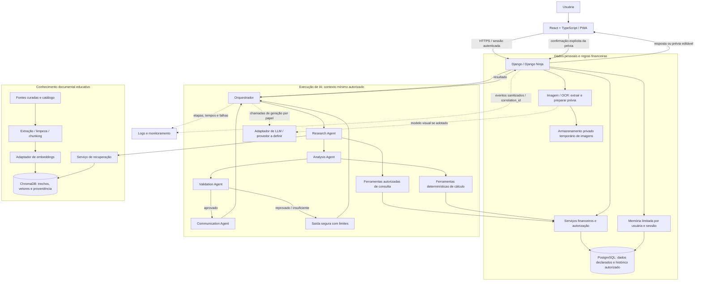

# Arquitetura inicial e responsabilidades

Data: 16/11/2026. Referência: [BASE-01, issue #55](https://github.com/anamattos2/grupo11challenge2/issues/55).

Estado: proposta inicial para revisão da equipe. Este documento especifica a
arquitetura a implementar; não certifica funcionalidades existentes. Conforme o
planejamento da equipe, todas as entregas partem de não iniciadas. Experimentos
RAG anteriores serão preservados e avaliados antes de qualquer reaproveitamento.

## 1. Objetivo e limites do MVP

Construir uma PWA de gestão financeira para mulheres em início de carreira,
com receitas e despesas declaradas, planejamento da reserva de emergência,
chat com evidências documentais e leitura de comprovantes por imagem.

O MVP inclui autenticação, perfil financeiro, contas manuais, categorias,
transações, meta da reserva, aportes, retiradas, dashboard, RAG, quatro agentes,
memória limitada, logs e tratamento de erros. Texto e imagem são as modalidades
de interação escolhidas; PDFs são fontes educativas da ingestão RAG.

Movimentação bancária real, Open Finance, sincronização bancária e recomendação
individual de ativos ficam fora do MVP. Saldos representam declarações da
usuária, não comprovação de patrimônio bancário.

## 2. Visão dos componentes e fronteiras de dados



As setas representam dependências lógicas, não serviços implantados separados.
O backend recebe as chamadas do navegador; PostgreSQL, Chroma e modelos não
ficam diretamente acessíveis à PWA. O pacote de IA pode executar no mesmo
processo do backend inicialmente, com interfaces que permitam separação futura.

| Fronteira | Conteúdo | Regra de acesso e uso |
|---|---|---|
| PostgreSQL | Usuárias, contas, transações, reserva e histórico autorizado | Fonte de verdade pessoal; toda operação filtra e autoriza pela sessão autenticada |
| Corpus e ChromaDB | Fontes educativas, trechos, vetores e metadados | Documentos nunca são interpretados como saldo ou gastos da usuária; dados pessoais e comprovantes não entram no índice educativo |
| Execução dos modelos | Pergunta e subconjunto necessário de dados/evidências | Sem credenciais de banco ou SQL livre; saída do modelo é não confiável até validação |
| Imagens temporárias | Comprovantes enviados pela usuária | Acesso privado por proprietária, retenção limitada e descarte definidos antes da implantação |
| Navegador e cache PWA | Interface e conteúdo permitido pela política de cache | Nenhuma persistência offline de dados financeiros até definir isolamento, limpeza e sincronização |

O backend deriva a identidade da sessão. Um `usuario_id` sugerido pelo modelo ou
pelo corpo da requisição não concede acesso. O Validation Agent acrescenta
checagens de consistência; autorização também é aplicada deterministicamente
nas ferramentas e serviços, antes de qualquer consulta ou alteração.

## 3. Responsabilidades e interfaces das frentes

As responsabilidades abaixo são técnicas. A distribuição nominal e a escolha
de revisores dependem da equipe; nenhum integrante recebe atribuição implícita.

| Frente | Responsabilidade | Interface de entrega e dependências |
|---|---|---|
| Frontend/PWA | Navegação, formulários, dashboard, chat, referências, prévia de imagem e estados de erro | Consome HTTP/JSON do Django; pode desenvolver com mocks dos contratos; não recalcula regras oficiais da reserva |
| Backend financeiro | Autenticação, autorização, persistência, validação e cálculos | API Django Ninja descrita em OpenAPI; fornece ferramentas tipadas à IA e respostas ao frontend |
| Dados/RAG | Catálogo, ingestão, metadados, embeddings, índice e recuperação | Recebe consulta/filtros e retorna evidências documentais; entrega reconstrução e avaliação de cobertura |
| IA/agentes | Quatro papéis, orquestração, adaptadores de modelo e respostas fundamentadas | Recebe contexto autorizado do backend; usa busca e ferramentas financeiras por contratos |
| Imagens | Validação do arquivo, extração estruturada e tratamento de ambiguidades | Produz prévia editável; usa backend para persistir somente após confirmação |
| Qualidade e avaliação | Dataset, gabarito, métricas, testes e revisão de evidências | Verifica contratos, isolamento, cálculos, citações, recusas e falhas entre frentes |
| Integração e operação | Ambiente reproduzível, CI, configuração e observabilidade | Documenta como executar aplicação, banco, modelos e índice; coordena diagnóstico de falhas |

Cada tarefa deve ter responsável e revisor definidos na issue antes da execução.
Alterações de contrato exigem exemplos atualizados e revisão pelas frentes que
produzem e consomem a interface. A implementação usará branches de tarefa e PRs
pequenos; este documento não autoriza commits ou publicação automática.

### Quatro agentes e coordenação

| Papel | Entrada | Saída e responsabilidade |
|---|---|---|
| Research | Pergunta e acesso a ferramentas com contexto autorizado | Evidências RAG e resultados financeiros, separados por tipo e origem |
| Analysis | Pergunta e evidências | Afirmações ligadas às evidências; solicita cálculos ao backend e registra dados insuficientes |
| Validation | Análise, evidências e resultados das ferramentas | Aprovação, alertas e alegações sem suporte; bloqueia inconsistências e citações inválidas |
| Communication | Conteúdo validado e limites | Resposta em português, com fontes e explicação breve de como sustentam as afirmações |
| Orquestrador | Requisição autenticada, contexto e memória permitida | Coordena os quatro papéis, valida schemas e controla timeout, falha e abstenção; não substitui nenhum agente |

A resposta final passa por checagem de estrutura e referências antes de sair do
backend, evitando que a etapa de comunicação introduza afirmações sem suporte.
Documentos, perguntas e texto extraído são dados de entrada, não instruções
autorizadas para conceder acesso ou executar ferramentas.

## 4. Contratos iniciais entre componentes

Estes são contratos conceituais propostos. URLs definitivas, schemas executáveis,
tipos completos e códigos HTTP serão especificados nas issues de implementação.

| Interface | Entrada mínima | Saída mínima / invariantes |
|---|---|---|
| Web → API financeira | Sessão, período, categoria ou operação validada | Valores decimais, moeda e período; autorização aplicada em cada operação |
| Web → chat | Pergunta e identificador de conversa pertencente à usuária | Estado, resposta, fontes, limites e `correlation_id` |
| Research → recuperação | Consulta, filtros documentais e limite de resultados | `evidencias[]`: ID do trecho, tipo documental, origem, página/seção, texto e score |
| IA → ferramenta financeira | Operação permitida e parâmetros tipados; contexto anexado pelo backend | Resultado determinístico com ID, período, moeda e origem financeira autorizada |
| Analysis → Validation | Dados usados, cálculos retornados e afirmações com IDs de evidência | `validacao`: aprovação, alertas, alegações sem suporte e motivo de bloqueio |
| Validation → Communication | Conteúdo aprovado, evidências e limites | `resposta`: texto, fontes e relação entre afirmações e evidências; ou abstenção segura |
| Web → extração de imagem | Sessão e arquivo validado | ID da prévia, campos extraídos, ausências, ambiguidades e aviso de possível duplicação |
| Web → confirmação da prévia | Prévia da própria usuária, correções e chave de idempotência | Despesa persistida uma vez; repetição não cria segunda despesa |

IDs de evidência distinguem dados financeiros de trechos educativos. Uma
evidência financeira pode ter documento/página ausentes, mas deve identificar
a ferramenta e o período consultado. Uma evidência documental deve localizar
seu trecho na fonte. Scores de recuperação não são probabilidades de correção.

### Regras determinísticas da reserva

- Meta = despesas essenciais mensais × meses de cobertura.
- Saldo declarado = saldo inicial + aportes confirmados − retiradas confirmadas.
- Progresso = 100 × saldo declarado ÷ meta, somente quando meta > 0.
- Meta zero ou informação insuficiente gera estado explícito, sem divisão por zero.
- Valores monetários usam decimais no backend; a IA explica os resultados retornados.

Exemplo inteiramente fictício: despesas essenciais de R$ 2.000,00 e cobertura de
3 meses geram meta de R$ 6.000,00. Saldo inicial de R$ 500,00, aporte de
R$ 200,00 e retirada de R$ 100,00 geram saldo de R$ 600,00 e progresso de 10%.
O período usado para obter as despesas essenciais está definido em
[contracts/reserva.md](../../contracts/reserva.md).

## 5. Fluxos de referência e falhas

1. **Pergunta sobre gastos pessoais:** API autentica a usuária; Research chama
   consulta financeira autorizada; Analysis usa o total calculado pelo backend;
   Validation confere consistência e proveniência; Communication explica o valor.
2. **Pergunta sobre reserva:** Research combina evidências educativas com dados
   pessoais autorizados; Analysis solicita cálculo da meta; Validation verifica
   suporte e dados ausentes; Communication diferencia cálculo pessoal e orientação
   documental, citando as fontes. Sem dados suficientes, pede complementação.
3. **Comprovante por imagem:** upload autenticado → validação → extração → prévia
   editável → confirmação explícita → serviço financeiro → PostgreSQL. Upload,
   extração ou resposta de agente não criam transação automaticamente.
4. **Falha ou inconsistência:** indisponibilidade de modelo, índice ou ferramenta
   interrompe a etapa dependente e produz estado compreensível. Reprovação não
   libera a análise original como resposta aprovada. O backend registra motivo,
   etapa e ID de correlação, sem mutação financeira indevida.

Memória fica limitada à usuária e à sessão autorizada; não altera a fonte de
verdade financeira. Logs devem registrar etapa, duração, status e correlação,
sem senhas, imagens completas, extratos ou prompts com dados pessoais em bruto.
Limites concretos de duração, volume e retenção ficam nas pendências abaixo.

## 6. Organização futura do monorepositório

Estrutura lógica proposta para a issue de organização do repositório. Os
diretórios abaixo não foram criados nem os arquivos existentes movidos nesta tarefa.

```text
apps/
  web/                         # React + TypeScript / PWA
  api/                         # Django / Django Ninja e regras financeiras
packages/
  ai/                          # Pacote Python instalável
    src/finance_ai/
      rag/
      agents/                  # Research, Analysis, Validation, Communication
      orchestration/
      images/
    tests/
contracts/                     # Schemas compartilhados e exemplos
knowledge/
  catalog.yaml                 # Identidade, origem e hashes das fontes
  sources/                     # Acervo educativo canônico
experiments/
  rag/                         # Notebooks e protótipos preservados
evaluations/                   # Datasets, gabaritos e baselines selecionados
infra/                         # Configuração de execução e implantação
docs/
  definicao/
  arquitetura/
  experimentos/
  avaliacao/
  entrega/
.github/                       # CI e convenções de colaboração
```

Testes específicos ficam próximos do componente; a localização dos testes de
integração entre componentes será definida na preparação do ambiente. Índices,
caches e uploads precisam de política de armazenamento antes da reorganização.
Snapshots existentes só serão retirados do rastreamento após preservação e
demonstração de reconstrução; não se propõe reescrever o histórico.

## 7. Registro de decisões iniciais

Todas as decisões abaixo compõem esta proposta e aguardam revisão da equipe.

| ID | Decisão proposta | Justificativa e consequência |
|---|---|---|
| D01 | React + TypeScript/PWA; Django + Django Ninja; PostgreSQL | Seguir PRD, centralizar contratos e regras no backend e permitir frentes paralelas |
| D02 | Separar PostgreSQL pessoal e Chroma educativo | Impedir que documentos sejam confundidos com registros financeiros; índice é reconstruível |
| D03 | IA em pacote Python com adaptadores de modelos e busca | Evitar quatro serviços independentes no início; provedor pode mudar sem alterar regras de negócio |
| D04 | Manter quatro agentes explícitos e um orquestrador | Atender ao requisito multiagente com responsabilidades e evidências observáveis |
| D05 | Cálculos e autorização determinísticos no backend | LLM não calcula saldos oficiais, executa SQL livre nem decide acesso |
| D06 | Escrita financeira por API e imagem com confirmação idempotente | Extração e conversa não são autorização de gravação; repetição não duplica despesa |
| D07 | Preservar experimentos e comparar antes de incorporar | Evitar descarte de pesquisa e assumir resultados anteriores como entregas concluídas |
| D08 | Memória limitada, minimização de contexto e logs sanitizados | Reduzir exposição e mistura de dados entre usuárias; retenção precisa de parâmetros explícitos |

## 8. Pendências e impactos

Os responsáveis indicados são frentes técnicas; nomes e prazos serão atribuídos
nas issues. Nenhum valor nesta tabela deve ser tratado como implementação pronta.

| ID | Definir | Frente que propõe / revisa | Momento necessário |
|---|---|---|---|
| P01 | Responsável e revisor de cada frente, disponibilidade e sequência | Equipe | Antes de distribuir implementação |
| P02 | Versões suportadas, gerenciadores de dependências e CI | Integração + backend/frontend | Preparação do ambiente |
| P03 | Modelo gerador, embeddings, OCR, execução local/remota e recursos | IA + RAG + imagens | Antes de fixar o baseline; decidir quais dados podem sair do ambiente |
| P04 | Autenticação, sessão, CSRF/CORS e recuperação de acesso | Backend + frontend | Antes de expor dados pessoais |
| P05 | Período de despesas essenciais, moeda, arredondamento e regras para retiradas | Backend + qualidade | Proposta na BE-05 em [contracts/reserva.md](../../contracts/reserva.md), sujeita à revisão do PR |
| P06 | Schemas executáveis, endpoints, erros e versionamento dos contratos | Produtores + consumidores | Antes de conectar componentes; liberar mocks |
| P07 | Dimensão do índice, parâmetros de busca e critérios de avaliação | RAG + avaliação | Antes de selecionar estratégia de recuperação |
| P08 | Provedor de implantação, HTTPS, configuração e armazenamento privado | Integração + backend | Antes de disponibilizar aplicação |
| P09 | Limites de upload, memória, retenção, exclusão e timeout | Backend + IA + imagens | Antes de integrar memória e upload |
| P10 | Cache offline, logout e estratégia de sincronização/idempotência | Frontend + backend | Antes de habilitar uso offline com dados pessoais |
| P11 | Critérios de aprovação, abstenção e tratamento da reprovação | IA + avaliação | Antes da demonstração dos quatro agentes |

## 9. Evidências para revisão da BASE-01

| Critério da issue | Evidência neste documento |
|---|---|
| Diagrama diferencia dados pessoais, conhecimento documental e modelos | Seção 2: diagrama Mermaid, fronteiras e regras de acesso |
| Responsabilidades e interfaces das frentes documentadas | Seções 3–5: responsabilidades, contratos e fluxos |
| Decisões e pendências registradas | Seções 7–8: decisões propostas, impactos e frentes responsáveis |

A revisão deve verificar separação das três fronteiras, presença dos quatro
agentes, cálculos no backend e confirmação antes de persistir imagem. Aceitar
este documento não conclui as issues de implementação. O fechamento da #55
depende da revisão da equipe e integração do PR correspondente.

## 10. Referências de planejamento

- [Issue #55 — Definir arquitetura inicial e responsabilidades](https://github.com/anamattos2/grupo11challenge2/issues/55).
- PRD v1.1 e Matriz de Rastreabilidade do Desafio 02, Grupo 11, de 16/11/2026,
  fornecido pela equipe no arquivo `PRD_v1_1_Desafio_02_Grupo11.html`.
- Cronograma semanal de referência, fornecido em
  `Cronograma Semanal_Superficial_Tudo_pode_mudar.docx`: S1 definição; S2 RAG;
  S3 avaliação e explicação estruturada; S4 quatro agentes; S5 multimodalidade;
  S6 integração; S7 entrega final. S8 Bridge sem obrigação adicional definida.

Os documentos de referência foram consultados localmente e não são copiados
para o repositório nesta tarefa. A localização versionada dessas fontes deve
ser definida pela equipe para permitir consulta por todos os integrantes.
