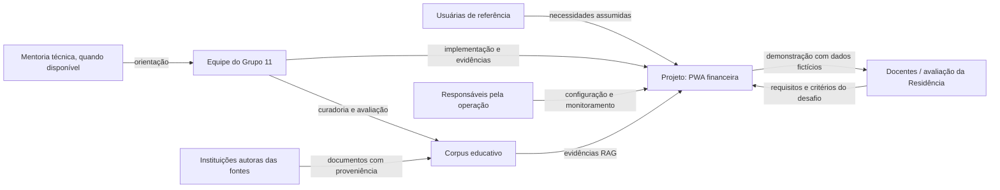

# Stakeholders e personas de referência

Referência: [S1-02 / issue #59](https://github.com/anamattos2/grupo11challenge2/issues/59).
Dependência: [S1-01 / #58](https://github.com/anamattos2/grupo11challenge2/issues/58).
Data: 16/11/2026. Estado: proposta para revisão da equipe.

Este documento identifica participantes, responsabilidades e necessidades
assumidas para orientar a implementação do Desafio 02, Grupo 11. As personas
são fictícias, elaboradas a partir do recorte do PRD. Não houve entrevistas,
amostragem ou validação de comportamento com usuárias reais nesta tarefa.

A #58 ainda depende de revisão e integração. Se seu recorte mudar, revisar este
documento antes de concluir a #59. A arquitetura de referência está na
[BASE-01](../arquitetura/arquitetura-inicial.md).

## 1. Mapa de stakeholders

O mapa descreve papéis e relações de trabalho; não atribui nomes ou representa
parcerias que não foram estabelecidas.

As usuárias de referência orientam o cenário de produto, mas a seta de
necessidades não representa uma consulta realizada. Os autores das fontes
fornecem conteúdo documental, sem aprovação ou endosso presumido à aplicação.
Operação e desenvolvimento podem ser exercidos pelos mesmos integrantes.

| Stakeholder | Interesse ou necessidade | Responsabilidade / limite | Relação com a entrega |
|---|---|---|---|
| Usuárias de referência: mulheres em início de carreira | Organizar registros, compreender a reserva e identificar limites da IA | Controlar seus registros e confirmar propostas de despesas; necessidades são premissas, não achados de pesquisa | Orientam fluxos e cenários fictícios |
| Equipe de frontend | Interfaces claras, contratos e estados de falha definidos | Navegação, dashboard, chat e prévia; não decide cálculos oficiais ou autorização | Implementa e demonstra a experiência web/PWA |
| Equipe de backend | Regras de negócio e fronteiras de dados explícitas | Autorização, persistência e cálculos determinísticos | Demonstra isolamento, integridade e ferramentas financeiras |
| Equipe de dados/RAG | Corpus rastreável e critérios de qualidade | Curadoria, ingestão, recuperação e proveniência | Entrega fontes, página/trecho e reconstrução do índice |
| Equipe de IA e imagens | Entradas, saídas e limites definidos | Quatro agentes, orquestração e extração; sem gravação financeira autônoma | Demonstra evidências, validação e revisão de comprovantes |
| Revisores e responsáveis pela avaliação técnica da equipe | Alterações verificáveis e evidências reproduzíveis | Revisar PRs, testes, dataset e métricas, sem declarar validação de mercado | Apoiam critérios de pronto e qualidade |
| Docentes e avaliadores da Residência | Atendimento aos entregáveis semanais | Avaliar evidências conforme orientação do desafio | Recebem pacote de definição, demos, relatório e apresentação |
| Mentoria técnica, quando disponível | Clareza do problema e das dificuldades | Orientação técnica; não substitui implementação ou revisão obrigatória | Contribui para decisões e tratamento de impedimentos |
| Instituições e autores das fontes educativas | Atribuição e uso compatível com as condições das fontes | Autoria do material, sem vínculo operacional presumido | Proveniência e condições de uso registradas no catálogo |
| Responsáveis pela operação | Ambiente executável e falhas diagnosticáveis | Configuração, retenção, acesso a serviços e logs sanitizados | Entregam instruções de implantação e monitoramento |

Os quatro agentes são componentes do sistema, não stakeholders humanos.
Serviços de modelo e hospedagem são dependências técnicas a selecionar, não
parceiros confirmados. Bancos e instituições financeiras não participam de
movimentação ou integração bancária no MVP.

## 2. Critérios de construção das personas

As personas variam situações úteis para demonstração: previsibilidade da renda,
completude dos registros e forma de entrada dos dados. Elas não representam
segmentos estatísticos nem afirmam frequência desses comportamentos.

Não são atribuídas idades, faixas salariais, escolaridade ou características
familiares como condições de uso. Nenhuma persona pressupõe que mulheres tenham
menor capacidade financeira ou hábitos uniformes de consumo. Os nomes a seguir
são inventados e não correspondem a integrantes ou participantes de pesquisa.

### Persona P1 — Clara: começar a organizar os registros

**Contexto fictício:** está no início da trajetória profissional, recebe renda
mensal previsível e começa a registrar despesas. Ainda não informou quais são
essenciais nem quantos meses deseja cobrir com a reserva.

**Objetivo:** entender receitas e despesas e obter uma meta calculada a partir
de informações que ela própria confirme.

**Necessidades assumidas:** cadastrar transações por categoria, distinguir
despesas essenciais, informar meses de cobertura e compreender meta e progresso.

**Dificuldade projetada:** uma resposta aparentemente precisa poderia esconder
dados ausentes. A interface e a IA precisam comunicar o que falta, sem inventar
valores ou escolher uma cobertura como se tivesse sido declarada.

**Cenário de demonstração:** perguntar pela meta antes de completar os dados;
o sistema indica o que falta. Depois da complementação, o backend calcula a
meta e a resposta explica os dados utilizados.

### Persona P2 — Luiza: acompanhar renda e registros variáveis

**Contexto fictício:** está iniciando atividades profissionais com recebimentos
variáveis. Registra entradas e despesas de períodos diferentes e não mantém
necessariamente um histórico mensal completo.

**Objetivo:** acompanhar o que declarou e entender como os dados disponíveis
participam do planejamento da reserva.

**Necessidades assumidas:** consultar por período, conferir dados incompletos,
registrar aportes e retiradas e consultar explicações educativas rastreáveis.

**Dificuldade projetada:** o sistema poderia tratar um período incompleto como
um mês representativo ou um exemplo de PDF como dado pessoal. O período e a
origem precisam aparecer nas consultas; regras de agregação ainda serão
definidas no backend, sem prometer renda futura.

**Cenário de demonstração:** consultar despesas de uma categoria em um período
informado, conferir o total calculado pelo backend e registrar um aporte
declarado. Uma resposta sobre reserva distingue esses registros das fontes RAG.

### Persona P3 — Marina: revisar comprovantes e entender explicações

**Contexto fictício:** está no início da carreira e quer usar imagens de
comprovantes para preparar registros. Uma imagem pode conter data ausente ou
mais de um valor, exigindo revisão.

**Objetivo:** aproveitar a extração de campos, mantendo controle sobre a despesa
que será registrada e sobre a interpretação das respostas da assistente.

**Necessidades assumidas:** visualizar campos sugeridos, corrigir informações,
confirmar ou cancelar a gravação e consultar fontes e limites no chat.

**Dificuldade projetada:** o sistema poderia gravar um valor ambíguo, duplicar
a despesa ou comunicar uma afirmação sem suporte. Extração é proposta editável;
uma resposta sem evidências deve se abster ou explicar a informação ausente.

**Cenário de demonstração:** enviar imagem sintética com dois valores, revisar a
prévia e confirmar a despesa correta. Repetir a confirmação não cria outro
registro. Uma consulta fora do corpus demonstra a abstenção da assistente.

## 3. Necessidades e rastreabilidade para implementação

As relações abaixo orientam requisitos futuros e não certificam funcionalidades
implementadas. A #60 detalhará os requisitos e seus critérios de aceite.

| ID | Necessidade assumida | Persona | Encaminhamento técnico |
|---|---|---|---|
| N01 | Consultar registros por categoria e período | P1, P2 | CRUD, filtros e totais calculados na API financeira |
| N02 | Entender quais informações faltam para a meta | P1, P2 | Validação determinística e estado explícito de dados insuficientes |
| N03 | Acompanhar saldo declarado, meta e progresso | P1, P2 | Reserva no PostgreSQL e dashboard com origem dos cálculos |
| N04 | Distinguir dados pessoais de exemplos documentais | P1, P2, P3 | Research com proveniência e Validation com checagens de suporte |
| N05 | Entender fontes e limites de uma resposta | P1, P2, P3 | RAG com localização e Communication com explicação estruturada |
| N06 | Revisar e confirmar campos extraídos de comprovante | P3 | Prévia editável, confirmação e idempotência na API |
| N07 | Ter dados isolados de outras usuárias | P1, P2, P3 | Autenticação e autorização no backend em toda consulta e mutação |

## 4. Premissas, limites e pontos de revisão

- O recorte de público vem do PRD; a equipe não demonstrou representatividade
  dessas personas nem adesão de usuárias.
- Os cenários são projetados para a entrega técnica e usam dados fictícios.
  Seus resultados não poderão ser reportados como avaliação com pessoas reais.
- Receitas, despesas e saldo são autodeclarados, sem conexão bancária ou
  comprovação de patrimônio.
- Variabilidade de renda não autoriza o sistema a estimar ganhos futuros ou
  recomendar individualmente ativos financeiros.
- Fontes educativas precisam de catálogo e condições de uso; não há endosso
  institucional ou relação contratual presumida com seus autores.
- Nomes de responsáveis, revisores e operadores serão definidos nas issues;
  esta matriz não concede acesso nem substitui permissões do sistema.

Na revisão, conferir alinhamento com o texto aprovado da #58, adequação das
necessidades ao MVP e ausência de alegações de pesquisa não realizada. Pesquisa
com usuárias, se vier a ser proposta, precisará de escopo e registros próprios.

## 5. Evidências para os critérios de aceite

| Critério da #59 | Evidência neste documento |
|---|---|
| Mapa de stakeholders disponível | Seção 1: diagrama, papéis, interesses, responsabilidades e limites |
| Personas e necessidades documentadas | Seções 2–3: três perfis fictícios, objetivos, dificuldades e necessidades rastreadas |
| Premissas identificadas sem alegar entrevistas realizadas | Introdução e seção 4: origem das premissas e limites metodológicos |

Este documento será insumo para o pacote de definição de 3 a 5 páginas (#62).
A conclusão desta tarefa exige revisão e integração do PR, incluindo verificação
da dependência #58. Não substitui a definição de requisitos, riscos ou métricas.

## 6. Referências de planejamento

- [Issue #59](https://github.com/anamattos2/grupo11challenge2/issues/59) e
  [definição de cenário e problema na #58](https://github.com/anamattos2/grupo11challenge2/issues/58).
- [Arquitetura inicial](../arquitetura/arquitetura-inicial.md).
- PRD v1.1 do Desafio 02, Grupo 11, de 16/11/2026, e cronograma semanal de
  referência fornecidos pela equipe na conversa. Esses arquivos de referência
  ainda não estão versionados nesta base.
