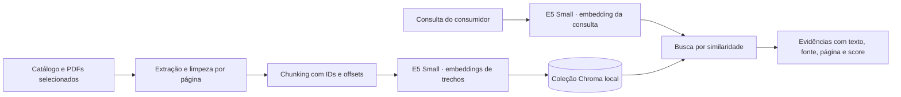

# Pipeline RAG educativo

A entrega cobre a preparação do acervo e a recuperação de evidências para
consumidores Python e agentes. A [arquitetura do sistema](../arquitetura/arquitetura-inicial.md)
mostra como o serviço de recuperação se conecta ao backend e ao agente Research.



| Etapa | Configuração e saída |
| --- | --- |
| [Catálogo](../../knowledge/catalogo.json) | Inventário de **20 PDFs identificados**, com ID, origem, SHA-256 e caminho. O acervo também inclui três PDFs com origem pendente e uma planilha auxiliar. |
| [Extração](extracao-documental.md) | PyMuPDF produz texto limpo por página física e registra páginas vazias ou erros. O SHA-256 vincula o texto ao arquivo de origem. |
| [Chunking](chunking-documental.md) | Janelas de até 1.000 caracteres Unicode, com 150 de sobreposição e limites por página. IDs determinísticos e offsets permitem localizar e reproduzir os trechos. |
| [Embeddings e índice](indice-vetorial.md) | Multilingual E5 Small com revisão fixada, vetores normalizados float32 de 384 dimensões em CPU e distância de cosseno. Cada coleção retém a configuração e reaproveita IDs numa reexecução. |
| [Recuperação](recuperacao-documental.md) | A consulta usa a mesma revisão do modelo. Por padrão, retorna até cinco evidências com similaridade mínima de 0,85. A resposta distingue consulta vazia, ausência de evidências e falha. |

## Demonstração reproduzível

Na raiz do repositório, com Python 3.12 a 3.14 e um ambiente virtual ativo:

```bash
python -m pip install -e './packages/ai[vector]'
python scripts/verificar_catalogo.py
FINANCE_AI_TEST_REAL_MODEL=1 python -m unittest discover -s tests -p 'test_retrieval.py' -v
```

O teste cria dois PDFs fictícios em um diretório temporário, `RESERVA` e
`SEGURO`, e executa catálogo, extração, chunking, embeddings, persistência
Chroma e busca. A primeira execução com o modelo real pode baixar os pesos.

| Consulta executada | Documento | Página física | Evidência | Score |
| --- | --- | --- | --- | --- |
| Para que serve a reserva de emergência? | `RESERVA` | 1 | Uma reserva de emergência cobre despesas essenciais em situações imprevistas. | 0,879 |

A execução retornou `status: ok` e uma evidência acima do limiar. O teste
também confirma o hash da fonte, os offsets do trecho e a ausência de
resultados quando o filtro aponta para um documento ausente. O score pode
variar ligeiramente entre ambientes.

Para uso acadêmico local com os 20 PDFs originais, o
[PR de reconstrução do acervo](https://github.com/anamattos2/grupo11challenge2/pull/120)
documenta o comando e a seleção de páginas. O banco e os catálogos gerados
ficam em `.runtime/`. A demonstração acima usa dados fictícios.
